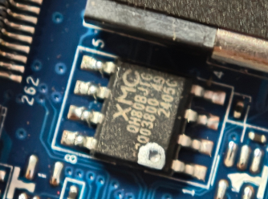

# EC reverse-engineering toolkit

Tools and findings for the ITE IT5571 EC in the Slimbook/WUJIE 14xa (`GX4HRXL`),
firmware `GXxHXxx_21.200`.

This repository owns the EC side — images, flashing, and the FlexiCharge
patch.

## Flash a patched EC

### 1. Get the official image

Use the vendor `GXxHXxx_21.200` image (256 KiB) from the update package.
You may download it from [here](https://cloud.slimbook.net/s/download?dir=/Laptops/Evo-14/Ryzen-8845HS/BIOS)

```sh
sha256sum GXxHXxx_21.200
# 34c050d30772da07ef262fc7016e0677b9b1b4cdcd90cf43d93f0f15bf6a38c2
```

### 2. Patch it

The builder pins the source digest, applies four reviewed byte-level patches, and
asserts the output digest, so a drifted offset aborts instead of producing an
unreviewed image.

```sh
uv run python firmware_mods/GXxHXxx_21.200/build-from-official-20261103/patch_ec_flexicharge_v22.py \
    GXxHXxx_21.200 flexicharge-v2.2.bin
# sha256: ff6683769da655f3cafa364ddc9cfcaad84ad28fa7122191d3fefad00a7a19cf
```

What FlexiCharge v2.2 actually changes — hook offsets, cave layout, the `0x0773`
persistence slot, the `0xA5/0x78` commit handshake and rollback limits — is written
up in [`docs/ec-firmware-flexicharge-v2.2-20260729.md`](docs/ec-firmware-flexicharge-v2.2-20260729.md)

### 3. Build the flasher

```sh
make -C tools/ec-flash
```

### 4. Write

> **Warning:** every `ec-flash` invocation enters Follow Mode: the fans spin up
> to full speed, the built-in keyboard is locked. Use an external USB keyboard
> and finish your work in 3 minutes or the watchdog will cut off your power.

```sh
sudo build/ec-flash --write flexicharge-v2.2.bin
```

Once it finishes, shutdown your computer, Then boot it up again.

If it goes wrong, recovery doesn't need a dead-board procedure: the EC image
lives on a separate SOP8 SPI flash right next to the DRAM socket 
(XMC XM25QH80, 1 MiB). Clip a programmer onto that chip and write
the original image back.



## Other entry points

| Path | Purpose |
|---|---|
| `tools/ec/i2ec_rw.py` | raw EC byte read/write over ports `0x681–0x683`; reaches the full 16-bit XRAM, including `0x0800–0x0BFF` that the 4 KiB H2RAM window cannot see |
| `docs/00-overview.md` | document map, confidence levels, open questions |

