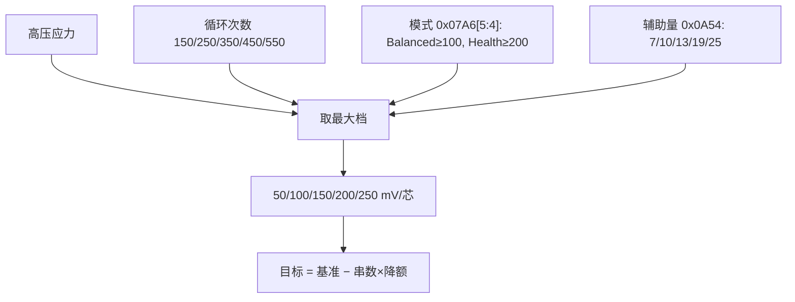
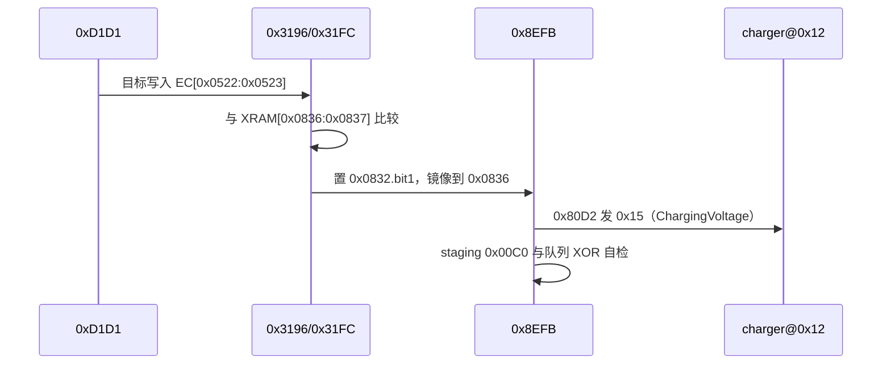

# 04 充电电压降额

EC 决定 charger 的目标电压，主机看到的只是结果。充电电压被压低有且只有一条主链：
**基准电压 − 串数 × 每电芯降额**，降额由四路条件取最大档。

## 1. 三种电压不要混

| 名称 | 地址 | 含义 |
|---|---|---|
| 实时包压 | `EC[0x0438:0x0439]` | 电池当前电压，只作高压窗口判定 |
| 未降额基准 | `XRAM[0x030E:0x030F]` | Gauge 报告的 `ChargingVoltage`（byte 命令 `0x0E/0x0F`，经描述表 `0x632E`） |
| EC 目标 | `EC[0x0522:0x0523]` | 实际下发给 charger 的值（LE） |

`XRAM[0x0836:0x0837]` 是目标的队列镜像，**不是** charger 回读值；不能用它证明外部
charger 已接受。

## 2. 数据来源

Gauge 在 SMBus 8 位地址 `0x12`（7 位 `0x09`），协议 `0x0C`。相关量：

| 量 | 入口 | 备注 |
|---|---|---|
| RSOC | `EC[0x04AB]` | 阶跃选择的输入 |
| 循环次数 | `EC[0x04A6:0x04A7]` | OEM byte 命令 `0x43` → `XRAM[0x0343:0x0344]` → 纯搬运 |
| 电池温度 | `EC[0x04A2:0x04A3]` | 0.1 K |
| 串数 | `EC[0x0491][7:6]` | `11b`=4S、`10b`=3S、其他=2S |
| 基准电压 | `XRAM[0x030E:0x030F]` | `< 500 mV` 时降额强制 0 |

下发用 SMBus 命令 `0x15`（ChargingVoltage），停充用 `0x14`（ChargingCurrent）置 0。

## 3. 门控

`bank1:0xD1D1 update_battery_aging_charge_voltage_derating`（2.10 约 `0xD173`）
由周期任务 `0x8FFB` 在 `0x9001` 调用，依次检查：

| 门 | 地址 | 不成立时 |
|---|---|---|
| 主机在线 | `EC[0x0741].bit0` (ApExist) | 清 `EC[0x07A6].5:4` 模式位 |
| 电池会话有效 | `EC[0x0490].bit1` | 清 `0x09C7–0x09CA` 并返回 |
| 遥测就绪 | `EC[0x0497].bit0`（`0xD1BB`→`0xE56F`） | 返回，不重算 |
| 辅助 hook | `EC[0x0490].bit2` | 跳过辅助量分支 |
| AC 在线（写回） | `EC[0x0490].bit0` | 不写回目标 |

## 4. 高压应力累计

Timer0 每 5.0009 ms 一次，144 tick ≈ 720.1 ms 一个调度单位：

```text
XRAM[0x09C7] += 1        每 720 ms
XRAM[0x09C8] += 1        每 60 × 720 ms ≈ 43.2 s
应力 += 温度权重          每 60 × 43.2 s ≈ 43.2 min，且仅在包压 ≥ 串数 × 4100 mV 时
```

温度权重（`EC[0x04A2:0x04A3]` 原始值）：`< 0x0BD6`（<29.85 °C）+1；`0x0BD6–0x0C3A`
+3；`> 0x0C3A` +7。累加前检查饱和 `0xFDE8`（65000）。
真机实测有效周期约 60.5 min，比静态值长，因为高压窗口不总是满足。

应力 `=(EC[0x09C9] << 8) | EC[0x09CA]`（大端）。

> 注意：`0x09C7–0x09CA` 的初始化表首字节为 `0x00`（空表），复位路径也不覆盖这一段。
> 冷启动读到的值可能来自 SRAM 上电残值，**用途可信、初值不可信**。

## 5. 降额档位（取最大）



| 每芯降额 | 循环次数 | 应力（严格 >） | 其他条件 |
|---:|---:|---:|---|
| 250 mV | ≥ 550 | `0x3DE0` (15840) | 辅助量 ≥ 25 |
| 200 mV | ≥ 450 | `0x2D00` (11520) | Health 模式至少此档 |
| 150 mV | ≥ 350 | `0x21C0` (8640) | 辅助量 ≥ 13 |
| 100 mV | ≥ 250 | `0x1950` (6480) | Balanced 模式至少此档 |
| 50 mV | ≥ 150 | `0x10E0` (4320) | 模板门槛为辅助量 7，但本项目在此处写 1，实际不触发 |
| 0 | < 150 | ≤ `0x10E0` | 且辅助条件不成立 |

判定顺序是从 250 向下，第一个命中即返回。

## 6. 下发链



细节：

- `0x3196` 比较 `EC[0x0522:0x0523]` 与队列；不等才排队。
- `0x31FC` 排队，或在特定条件下把回退值 **12600 mV** 写入 `0x0836:0x0837`。
- `0x8EFB` 消费 `XRAM[0x0833].bit1`（电压）/`.bit0`（电流）。
- `0xDF0B` 构造描述符 `{cmd, 0x00, 0xC0, 0x00}`，staging 在 `0x00C0:0x00C1`。
- `0x80D2` 执行传输：成功 `0x0A73=0x00`、`0x0A75=1`、`R7=1`；失败 `0x0A73=0xEE`、
  `0x0A75=0`。worker **不检查**这三个结果，只做 staging 与队列的 XOR 自检。
- 队列镜像与期望不符时重置 `0x0832`。

## 7. INT1 寄存器污染（确定的 ABI bug）

`0x0013 → 0x0559` 的 INT1 ISR：保存 `ACC/B/DPH/DPL/PSW` 后 `MOV PSW,#0x10` 进入 bank2，
**不保存 R0–R7**。主线 `PSW=0x16` 也在 bank2，于是 ISR 与主线共用同一组物理寄存器。

现场证据：`D1BB` 正常返回 `R7=1`，但 `XRAM[0x0A54]` 与 `XRAM[0x039D]` 出现 `0x1B`、
`0x2E`、`0x31` 等值，直接命中 250 mV 档。

修复（已实机验证，29 字节差异）：

```text
0x0566: LCALL 0x14C8      → LJMP 0x7E6A
0x05B2: 改为 LJMP 0x7E78（跳过原 SETB/POP，收尾在 cave 内完成，再回 0x05B6）
0x7E6A: C0 17 30 6E 06 12 14 C8 02 05 B2 02 05 6E
0x7E78: D0 17 D2 6C D0 D0 02 05 B6
```

`PUSH 17h`（bank2 的 R7）必须放在 `MOV PSW,#0x10` 之后、`POP PSW` 之前。
不能用 `MOV PSW,#0x18` 切 bank3：`bank1:0x9A03` 有可达的 `MOV 0x1C,@R0`，bank3 的
R4 槽正在使用。

验收：

- `EC[0x0490].bit0=1`、`EC[0x0497].bit0=1`；
- `XRAM[0x0A54]` 稳定为 1，`XRAM[0x039D]` 不再随 `0x1B` 跳变；
- Normal + 循环 <150 + 应力 ≤ `0x10E0` 时目标回到 17600 mV。

## 8. 现场案例

| 现场 | 数据 | 结论 |
|---|---|---|
| 2026-07-19，17.0 V | 应力 `0x2BDC` = 11228，落 150 档，4S | `4×150 = 600`，`17600−600 = 17000` |
| 2026-07-21，16.6 V | `XRAM[0x0A54] = 0x1B = 27` → 250 档 | `4×250 = 1000`，`17600−1000 = 16600` |
| 2026-07-22，16.6 V | 现场辅助量 = 2，应力 `0x0030`，循环 59 | 无法用输入复现，判定为旧 target 残留 |

第三种现场至今未闭合：`0x0A54` 的写入者没有被直接追踪到，INT1 只是可证的 ABI 风险，
不是已证实的生产者。

## 9. 不是本链原因的因素

温度只影响累计速度；AC 拔插不清应力但会重开写回资格；刷固件/复位不清老化 word；
60%/80% 停充属于 05 章的 SOC 策略；实时包压偏低、USB-C/PD 能力、charger 硬件保护、
模拟环路偏差均未证实参与。

## 10. 证据

`_archive/battery_aging.md`（全量推导与阈值）、`_archive/charging_voltage_reduction_causes.md`
（原因清单与复核表）、`_archive/i2ec_battery_investigation.md`（实读值）、
`_archive/mermaid/charging_judge_graph.mermaid`、`_archive/firmware_mods/charging_voltage_isr_repair_20260722.md`。
