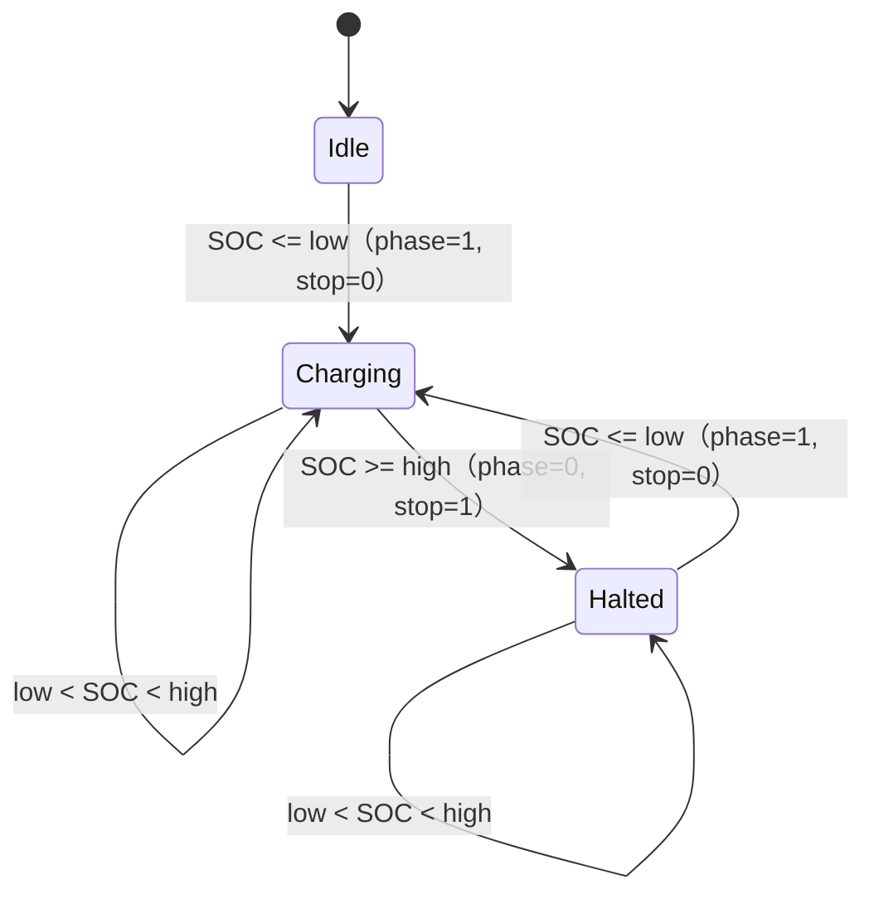

# 05 容量校准与充电上下限

两件互不相干的事放在一章：**EC 自己重算 FCC**（校准），和**主机设定 SOC 上下限**（限充）。

## 1. 遥测发布

Gauge（SMBus 8 位地址 `0x12`）提供原始值，EC 发布到 `EC[0x04xx]`：

| 发布字段 | 地址 | 来源 |
|---|---|---|
| 当前容量 | `EC[0x0402:0x0403]` | Gauge `0x18` |
| 满充容量 FCC | `EC[0x0404:0x0405]` | `XRAM[0x0342] × 100` |
| 设计容量 | `EC[0x0406:0x0407]` | Gauge |
| 电压 | `EC[0x0408:0x0409]` | Gauge `0x19` |
| RSOC | `EC[0x04AB]` | Gauge |
| 循环次数 | `EC[0x04A6:0x04A7]` | OEM byte `0x43` → `XRAM[0x0343:0x0344]`，`0x69F6` 纯搬运 |
| 最大误差 | `EC[0x0436:0x0437]` | Gauge `0x0F` |

`0x00–0x1C` 是厂商 byte-register 窗口，不是标准 SBS 字段：word-read 返回“当前字节 +
下一字节”，循环次数只存在于 OEM byte `0x43`。EC 也没有提供容量因子的命令 `0x42`。

## 2. 校准状态机

状态变量 `XRAM[0x03A3] & 7`，分派入口 `bank1:C7EA`：

| 状态 | 入口 | 作用 |
|---:|---|---|
| 0 | `C80C` | 等待低电量充电起点 |
| 1 | `C86D` | 建立低压基线 |
| 2/3 | `C8A5` / `C8FB` | 充电积分与阶段转换 |
| 4 | `C907` | 满充终点确认 |
| 5 | `C96E`（下一状态 `C970`） | 计算并提交 factor |
| 6 | `C9B6` | 发布 FCC |
| 7 | `C9CC` | 失败汇合 |

### 起点（状态 0，四个条件同时成立）

1. 队列电流 `XRAM[0x0834:0x0835] != 0`（`0x1B40 → bank0:A6C3`）；
2. `XRAM[0x0514] <= 12`；
3. `XRAM[0x03A2].bit3 == 1`；
4. 包压（`0x0363:0x0364` 或 `0x0384:0x0385`）`<= XRAM[0x03D2:0x03D3]` = **14820 mV**
   （4S ≈ 3.705 V/芯）。

也就是必须**先放到 RSOC ≤ 12% 再充**。

### 积分（状态 2/3）

- 仅充电方向、且 ChargingCurrent 门有效时累计；
- `0x0361` 去抖，连续 **128 次**条件不满足则放弃（状态 7）；
- 积分常数 `0x4650 = 18000`（3600 / 0.2，对应 mA、0.2 s 周期 → mAh），余数存
  `XRAM[0x03B2:0x03B3]`；
- `XRAM[0x0388:0x0389]` 只记充电累计，`XRAM[0x038A]` 是双向吞吐，别混。

### 终点（状态 4）

- `XRAM[0x0834:0x0835] == 0`；
- 连续 **64 次**满足；
- `XRAM[0x0347] == 100`；
- `XRAM[0x04AE:0x04AF] < 0x0168`（360，疑似终点电流阈值，命令未定）。

### 提交（状态 5/6）

```text
factor = CLAMP(charged_mAh / 100, old_factor − 3, old_factor + 3)
XRAM[0x0342]        = factor
XRAM[0x0340:0x0341] = factor × 100
XRAM[0x03A1].bit1   = 1        ← pending
XRAM[0x03A3]        = 6
```

发布函数 `bank1:DA8E` 在 `XRAM[0x0342] == 0x03C0` 时把 `factor × 100` 写入
`EC[0x0404:0x0405]`；状态 6 等 pending 被消费后写 `0x0575 = 8`、`0x91F3 = 8`。

单轮上限：旧 FCC 3700 mAh（factor 37）最多接受 40 → 4000 mAh，**一次合格循环最多改约
300 mAh**。factor 基数是 100，不是 SOH 百分比。

### 职责边界

EC 只做“积分 + 受限 factor + 发布”，**不**发 `ManufacturerAccess(0x00)`、不 unseal、
不写 Gauge Flash。Gauge 供原始数据，校准结果留在 EC 的 XRAM 与 `EC[0x0404]`。

## 3. 充电上限 `EC[0x07B9]`

| 位 | 含义 |
|---|---|
| `[6:0]` | 上限百分比，`0` 表示 100 / 不限 |
| `bit7` | 停充标志（1 = 停） |

### 原厂恢复链（冷启动）

```text
OEM 0x47 / 0x48  →  EC[0x0A47] / EC[0x0A48]
  → 一致性 + 范围校验
  → EC[0x087F]
  → 保留 0x07B9.bit7，合并 0x087F[6:0]
失败回退：0x087F = 100，0x07B9 = 0
```

`0x47` 与 `0x48` 是**同一上限的冗余副本**，不是 high/low。

### 写回链

`bank2:D741` 比较 `0x087F` 与当前上限，不等则写 `0x087F`、置 `0x0802 = 6` 倒计时；
到 1 时 `LCALL 0x1B88`（`MOV DPTR,#0xDB98; LJMP 0x1100` → `bank0:DB98`）。
`bank0:DB98` 是原厂通用配置同步框架，含两块映射：

- 4 字节主块：`0x9400, 0x9401, 0x0706, 0x087F`；
- 16 字节块：`0x0770..0x077F`。

冷启动在 `bank0:DE03` 再把 `0x087F` 合并进 `0x07B9`。

16 字节块的映射表在 `bank0:602B`（地址连续 `0x0770..0x077F`）；`bank0:DC02` 在记录有效时
把 `0x0200..0x020F` 恢复回去，`bank0:DC2A` 反向收集并提交。保存握手：
`EC[0x077E] = 0xA5`、`EC[0x077F] = 0x78`，调度器 `bank0:C4F5–C527` 识别后改成
`0x55/0xAA` 并调 `bank0:DC2A`。提交粒度是整块，不是单字节。

### 判定与物理闭环

决策段 `bank2:D729`：读 RSOC `0x04AB` → `SUBB A,R3`（R3 = 上限低 7 位）→
低于阈值走 `D73A` 清 `0x07B9.bit7`（恢复充电），否则 `D735` 置停充。

```text
0x07B9.bit7 → bank1:0xB08F / 0xC099
  → EC[0x0432] = 2（停）/ 0（充）
  → bank1:0xBA4A → EC[0x0574]
  → thunk 0x165A → bank2:0x9D9F
  → EC[0x0850]，R7 = 0x07（停）/ 0x06（充）
  → bank1:0x9DB7 → LCALL 0x8686 → 0x8015 → LCALL 0x8259
  → SMBus ChargingCurrent(0x14) = 0
```

## 4. 充电下限 `EC[0x07D0]`

原厂固件**零引用**：`MOV DPTR,#0x07D0` 全镜像 0 命中，拆分的 `MOV DPH/DPL` 0 命中，
字节序列 `07 D0` 0 命中；没有 shadow、没有 `0x0802=6` 触发、没有配置表映射、
没有冷启动恢复。官方 GCU 定义了 `ADDR_BATTERY_CHARGE_LIMIT_DOWN = 2000 = 0x07D0`，
但 EC 不消费。所以原厂只有 upper-only 语义。

## 5. FlexiCharge v2.2

### 寄存器语义

| 字段 | 含义 |
|---|---|
| `EC[0x07B9][6:0]` | 上限；`0` = 100 / 不限 |
| `EC[0x07B9].bit7` | 停充（原厂语义，保留） |
| `EC[0x07D0][6:0]` | 下限；`0` = 禁用 |
| `EC[0x07D0].bit7` | 易失 cycle-active phase |
| `EC[0x0773].bit7` + `[6:0]` | 持久化的下限记录（bit7 = 有效） |

有效窗口：`1 <= low <= 95`、`high != 0`、`low < high`。
`low=0,high=0` = canonical disabled；`low=0,high>0` = 官方 upper-only；
`high=0,low>0`、`high<=low`、`low>=96` 为 invalid：只清两个 bit7，不清低 7 位。

### 迟滞



phase 不能省：它区分“首次在中间区间插入”和“低点启动后中途拔插”。

### 实现

- v2.1：hook `bank2:D729` 与 `bank2:D73A`（`0x1D729`、`0x1D73A`，代码洞
  `0x7E6A–0x7F41`）；产物 SHA-256 `41a193ce525e1d87cea5d31b30e29eb9755e60b9d25862b187ed234980749bd8`。
- v2.2：增加持久化。`0x0DE54` 原 `12 DE 03` → `12 7E 6A`（先执行原 `LCALL bank0:DE03`，
  再按 `0x0773` 恢复 low 到 `0x07D0`）；另两处 hook `0x1D729 → 7E7B`、`0x1D73A → 7EAF`；
  代码洞 `0x7E6A–0x7F70`（263 B）。产物
  SHA-256 `ff6683769da655f3cafa364ddc9cfcaad84ad28fa7122191d3fefad00a7a19cf`，26 项测试通过。
- 提交条件：仅当 `0x0773.bit7 == 0`，或 `(0x0773 & 0x7F) != (0x07D0 & 0x7F)` 才写，
  避免每 1–2 秒写 Flash；随后 `0x077E=0xA5`、`0x077F=0x78` 触发原厂提交。

真机：初始 `0x0773 = A8`（low 40），设 `-d 60 -u 80` 后 `0x07D0: 28→3C`、`0x07B9`
仍 `D0`；再 dump 得 `0x0773 = BC`（low 60）、`0x077E/7F = A5/78`。

### 边界

- 关机后 EC 真掉电，`0x07B9.bit7` 与 `0x07D0.bit7` 都会丢；启动后按持久化 high/low +
  实时 SOC 重建 phase。
- 配置事务的逻辑块 ID 是 `0x01F0`（16 B）/`0x01F4`（4 B），介质高概率是外接 SPI Flash 的
  配置/EEPROM 仿真区；**逻辑块 ID ≠ Flash 文件偏移**。
- 只有 GXxHXxx 21.200 验证过；其他机型能否复用 `0x0773` 未证。

## 6. 证据

`_archive/battery_calibration/battery_calibration_trigger_audit_20260721.md`（状态机权威）、
`_archive/battery_calibration/battery_charge_log_firmware_findings_20260722.md`（日志交叉）、
`_archive/charge_limits/charge_soc_limit_consumers_investigation_20260725.md`（消费链）、
`_archive/charge_limits/charge_limit_upper_restore_logic_20260729.md`（v2.2 与槽位审计）、
`_archive/charge_limits/flexicharge_v2_1_patch_20260729.md`（v2.1 历史）。
