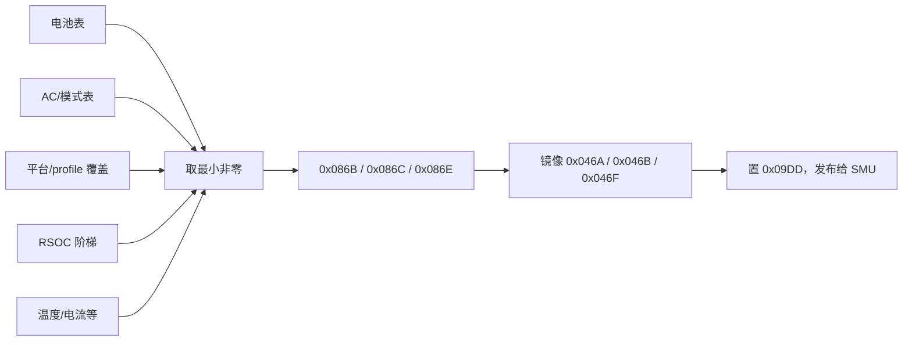

# 06 功耗与风扇

功耗限制不是单一寄存器，而是**多来源候选按“取最小非零”仲裁**后的结果；
风扇同理由多张表与多个 gate 共同决定。

## 1. 模式寄存器

`EC[0x0751]`：Gaming `0x00`、Office `0xA0`、Turbo `0x10`。表选择只取 `& 0x90`
（→ `0x00/0x80/0x10`），FanBoost 的 bit6 不参与。

## 2. 调用链

| 调用点 | veneer | 目标 |
|---|---|---|
| `bank1:0x8E47` | `0x1C36: 90 B7 61 / 02 11 14` | `bank1:0xB761` 最终仲裁 |
| `bank1:0x8E4A` | `0x1C3C: 90 B9 9D / 02 11 14` | `bank1:0xB99D` AC/电池候选构建 |

门控：

- `0xDF87` = `EC[0x0490].bit0`（EC 内部去抖后的 AC present）；
- `0xDF77` = `EC[0x06E6] ^ 0x01`；
- 电池路径要求 `0x0490.bit0 == 0 && EC[0x06E6] == 1`（`B9EA: 12 DF 87 / 70 05`、
  `B9EF: 12 DF 77 / 60 11`）。

## 3. 平台与表

平台识别 `0xD4C4`：`EC[0x07C3] == id || EC[0x0770] == id`。本机 `0x07C3 = 0x05`、
`0x0770 = 0xFF`、`0x0885 = 0x41`（profile）、`0x06E6 = 1`，走 ID `0x05` 分支。

profile `0x41` 的三张表（fixed common）：

| 模式 | 表地址 |
|---|---|
| Gaming | `0x76F2` |
| Office | `0x773A` |
| Turbo | `0x76AA` |

格式：每模式 8 项 × 9 字节；byte0 = RSOC 阈值，byte1 = STAPM，byte2 = SPPT，byte3 = FPPT，
byte4–8 未完全解读。`EC[0x0983].bit1` 选择前 4 项（正常组）或后 4 项（降额组），
判定帮助函数 `0xE944: ANL A,#0x02`。RSOC 源 `EC[0x04AB]`，按阶梯缩放。

电池表（STAPM/SPPT/FPPT，W）：

| RSOC | Gaming | Office | Turbo |
|---|---|---|---|
| < 31% | 25/25/25 | 15/20/25 | 25/25/25 |
| 31–69% | 28/30/35 | 15/20/25 | 35/35/35 |
| 70–89% | 28/30/35 | 15/20/25 | 45/50/50 |
| ≥ 90% | 28/30/35 | 15/20/25 | 48/54/60 |

降额组（`0x0983.bit1 = 1`）整体更低：低电量段全部 15/15/15，高电量段 Gaming/Turbo
约 25/25/30–35/35/40。完整 8 行见 `_archive/performance_power/…_20260726.md` §8。

## 4. 候选与仲裁

| 来源 | 槽位 |
|---|---|
| 电池 | `0x0872` / `0x087A` / `0x088A` |
| AC / 模式 | `0x0873` / `0x087B` / `0x088B` |

AC 路径先清 `0x0983.bit1` 并清电池槽。`bank1:0xB761` 遍历所有候选，取**最严格的非零值**：

`0xE5DE store_and_invalidate_published_power_limits` 把值写入 DPTR 后清三个镜像，
不是风扇 telemetry 清理。

实测（AC=1、RSOC 80%、`0x0751=0x10`、`0x0983=0x20`）：候选 `54/65/70`，最终
`0x086B/0x086C/0x086E = 54/65/70`，`ryzenadj -i` 读到 STAPM 54.000 / Slow 65.000 /
Fast 70.000，完全一致。

## 5. AP / Custom 覆盖

| 项 | 地址 | 作用 |
|---|---|---|
| APExist | `EC[0x0741].bit0` | `0xDF7F: 90 07 41 E0 54 01 22`；`0xE611` 主动清除（`C949`、`CB3F`；`C944` 在 `0x06E6==5` 时清） |
| 功耗覆盖 | `0x0783/0x0784/0x0785` | APExist + `0x0727.bit6` 时覆盖到 `0x08C0/0x08C1/0x08C3` |
| 辅助值 | `0x078B` | `>0` 时 `0x08BB = 0x078B − 1` |
| TCC | `0x0786` | bit7 使能、低 7 位目标 → `XRAM[0x0A4C]`、`EC[0x098C]`、`EC[0x0463] = tcc \| 0x80` |

AP 不在时 `0xC47C` 清空这些输入。Custom 模式没有单一开关，是三组 gate 的交集。

## 6. 风扇

| 量 | 地址 | 说明 |
|---|---|---|
| 主 duty | `EC[0x075B]` | 原始 duty，`raw/2 ≈ %`，钳位 `0xC8`（不是 RPM） |
| 副 duty | `EC[0x075C]` | 同上 |
| 主 RPM | `EC[0x0464:0x0465]` | 由 tach 换算 |
| 副 RPM | `EC[0x046C:0x046D]` | 低字节是 `0x046D`，**不是** `0x046B` |
| tach 原始计数 | `XRAM[0x181E..0x1821]` | `RPM = floor(2_156_250 / count)` |

真机校验：count 499 → 4321（`0x10E1`）、508 → 4244（`0x1094`），公式吻合。

`EC[0x046B]` 在 21.200 是 final slow PPT 镜像；GCU 的
`SECOND_FAN_RPM_BYTE2 = 0x046B` 是跨机型/旧代遗留常量，不能用于本机。
`0x046A/0x046B/0x046F` 是功耗镜像，不是风扇字段。

`0x0F5D/0x0F5E/0x0F5F` 平时是第二路 duty `[13..15]`；写入 `mode / 0xFD / 0xC9` 时被复用为
ROM 默认风扇表导出握手：`bank1:0x93E9–0x940D` 校验、`0x941B` 选表、两次 `LCALL 0x7A97`
各复制 `0x30` 字节到 `0x0F00` 与 `0x0F30`。

风扇曲线：两组 48 字节 XRAM 表；主曲线与副曲线各自维护 index 与迟滞，Custom 路径取
`max(index0, index1)`；`0x07C6.bit2` 是 AP 风扇管理使能，`0x0726.bit7` 只是启动/恢复窗口内
的一个 gate，不是可靠的主开关。

## 7. 为什么手改 `ryzenadj` 会被覆盖

最终值由 EC 周期性重新仲裁并发布给 SMU。直接写 SMU 后，EC 下一轮发布又会覆盖，
所以官方 UI 的限制与 EC 的限制是**两层**；电池上切 Turbo 只选到“Turbo 电池表”，
达不到插电 Turbo 的数值。

## 8. 证据

`_archive/performance_power/ec_ac_battery_power_profile_investigation_20260726.md`
（表值、仲裁、风扇全量）、`_archive/mermaid/charging_smbus_comm_graph.mermaid`（电压下发链，
与功耗发布是同构的 worker 模型）。
